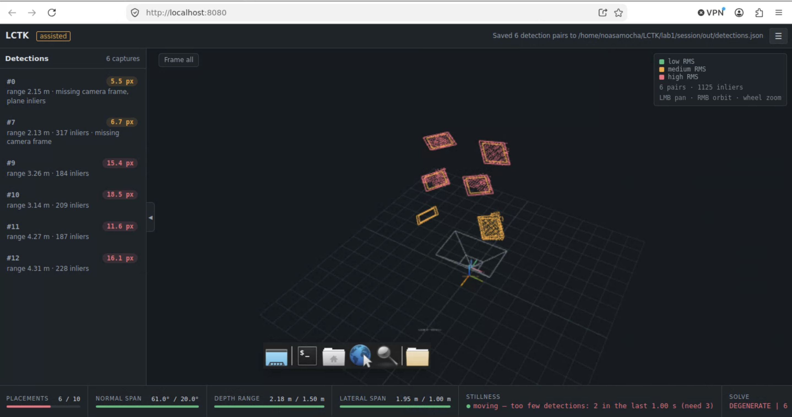
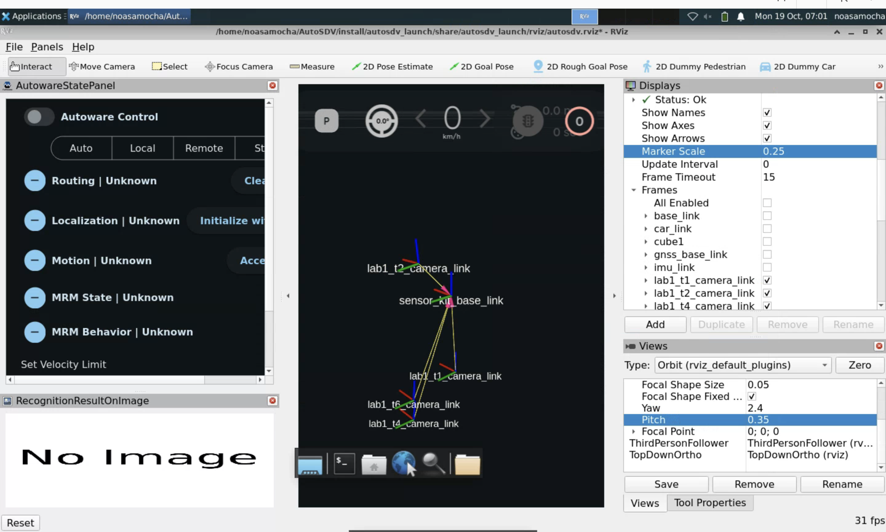

# LiDAR–Camera Extrinsic Calibration

The goal: estimate the rigid transform from a Seyond Robin-W LiDAR to a ZED X Mini camera with LCTK, build calibrations from fewer and fewer board placements, and integrate the results into AutoSDV's sensor kit so they can be compared in RViz.



## Workflow

1. **Session setup.** I configured an LCTK session with the recording's LiDAR and camera topics, the `solid_600` ArUco target and the Robin-W detector settings, and checked it against `ros2 bag info`.
2. **Calibration.** I ran LCTK in assisted mode on the recording, and it kept 15 Captures. The beginning of the bag, before the board appears, served as the background warm-up for LiDAR board detection.
3. **Nested subsets.** I removed placements step by step and exported a calibration after each step. I chose the placements so that the remaining boards stay spread over different distances and sides:

   | Calibration | Placements | Board positions |
   | --- | --- | --- |
   | T6 | 6 | near left, near right, middle centre, middle left, far left, far right |
   | T4 | 4 | near left, near right, middle centre, far right |
   | T2 | 2 | near left, far right |
   | T1 | 1 | far right |

4. **Conversion and integration.** I converted each result into a camera mounting-link pose with `lctk_to_autosdv.py`, added the four frames to AutoSDV, and verified them in RViz and with `tf2_echo`.

## The converter

LCTK outputs the transform from the LiDAR frame to the **camera optical frame**, as a Rodrigues rotation vector (`rvec`) and a translation (`tvec`): `p_camera = R(rvec) · p_lidar + tvec`. AutoSDV needs the pose of the **camera mounting link** relative to `sensor_kit_base_link`.

`lctk_to_autosdv.py` chains three 4×4 transforms:

```
T_base←link = T_base←lidar · (T_optical←lidar)⁻¹ · (T_link←optical)⁻¹
```

- `T_base←lidar` is read from the existing `robin_w` entry in AutoSDV's `sensor_kit_calibration.yaml`.
- `T_optical←lidar` is the LCTK result.
- `T_link←optical` is the fixed ZED X Mini offset between its mounting link and its optical frame.

The script prints x, y, z (m) and roll, pitch, yaw (rad) for each calibration as YAML, ready to paste into the sensor-kit file.

```bash
python3 lctk_to_autosdv.py \
    --detections-dir <detections-dir> \
    --yaml <AutoSDV>/.../autosdv_sensor_kit/sensor_kit_calibration.yaml \
    --lidar-link robin_w
```

Dependencies: Python 3, NumPy, SciPy, PyYAML.

## Results

| Frame | x (m) | y (m) | z (m) | roll | pitch | yaw |
| --- | --- | --- | --- | --- | --- | --- |
| `lab1_t6_camera_link` | 0.077 | 0.040 | −0.254 | 0.025 | −0.058 | 0.000 |
| `lab1_t4_camera_link` | 0.085 | 0.035 | −0.309 | 0.031 | −0.088 | 0.002 |
| `lab1_t2_camera_link` | 0.058 | 0.033 | 0.059 | −0.079 | 0.047 | −0.003 |
| `lab1_t1_camera_link` | 0.032 | −0.042 | −0.196 | −0.030 | −0.014 | 0.017 |



- All four estimates face forward.
- T6 places the camera about 8 cm in front of and 25 cm below the LiDAR, which is plausible for the vehicle. T4 is within about 6 cm of T6.
- With fewer placements the estimates drift. T2 even puts the camera *above* the LiDAR, which contradicts the physical setup, so two placements did not constrain the calibration well enough.

The second part of the lab measures these calibrations quantitatively: see [reprojection-error](../reprojection-error).

## Challenges

- **The recording.** It covered only 7 of the 9 planned board positions and had almost no yaw variation. This limited the later comparisons.
- **Degenerate geometry.** LCTK flagged the calibration as not well constrained (degenerate), because 9 of the 15 Captures were at about 2 m. I chose T6 to cover near, middle and far distances, but the warning stayed.
- **Wrong default LiDAR.** The converter initially defaulted to the VLP-16 LiDAR. I switched it to `robin_w` and checked its output against the YAML.
- **Empty RViz views.** LCTK's RViz config used different topic names, so its views were empty. I made a copy with this rig's topics and frame.

## Files

| File | |
| --- | --- |
| `lctk_to_autosdv.py` | LCTK result → AutoSDV mounting-link pose |
| `autosdv-integration/sensor_kit_calibration_additions.yaml` | The four entries I added to AutoSDV's sensor-kit calibration |
| `autosdv-integration/sensor_kit_additions.xacro` | The four fixed joints I added to AutoSDV's sensor-kit URDF |
